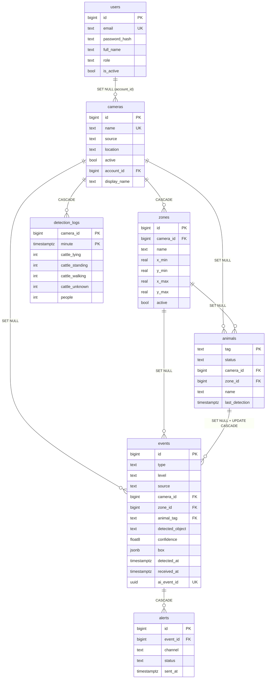
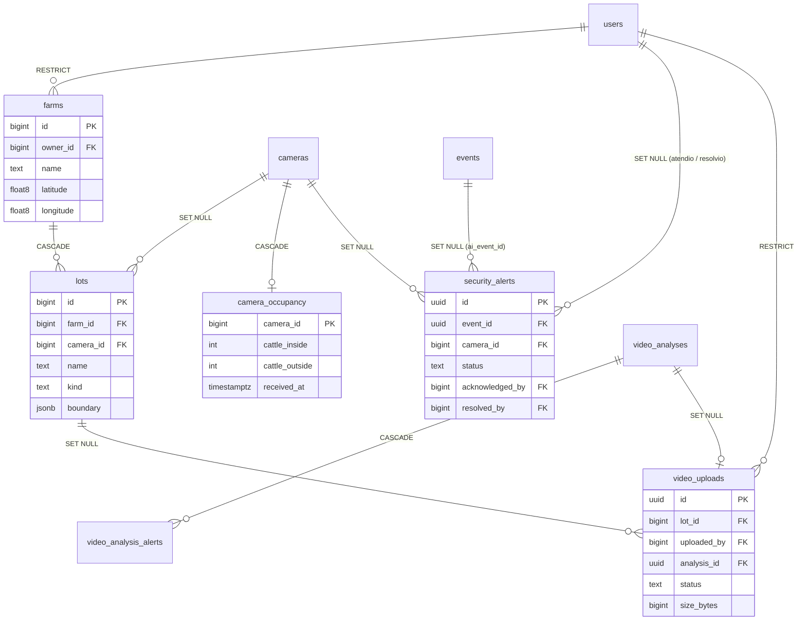

# Modelo de datos

De las tablas compartidas, a `users` solo la referencia `cameras`, por su cuenta
duena: los eventos y las detecciones llegan a la cuenta **a traves de su camara**.
Los eventos no registran quien los atendio y las alertas no registran a quien se
le mandaron; eso esta en las tablas del backend, en el diagrama siguiente.

## Las tablas del backend

Las crea y escribe solo SmartCattle-Backend (ver
[diccionario/tablas-del-backend.md](diccionario/tablas-del-backend.md)). Se
cuelgan de las compartidas, nunca al reves: ninguna tabla de `schema.sql`
apunta a una del backend.

Los dos `RESTRICT` son a proposito: borrar una cuenta no puede llevarse fincas
ni videos por efecto colateral. Primero se reasignan, o la cuenta se desactiva
con `is_active`, que es como se retira el acceso.

## Lo que dice el diagrama de un vistazo

En este primer diagrama, tres relaciones borran en cascada: `zones` y
`detection_logs` con su camara, y `alerts` con su evento. Las demas hacen
`SET NULL`, y esa asimetria es la regla del esquema:
**el historico sobrevive a que se retire su origen**, salvo cuando la fila no
significa nada sin el.

`animals` a `events` es la unica que ademas lleva `ON UPDATE CASCADE`, porque
es la unica clave ajena que apunta a una clave primaria natural, y una clave
natural si cambia.
