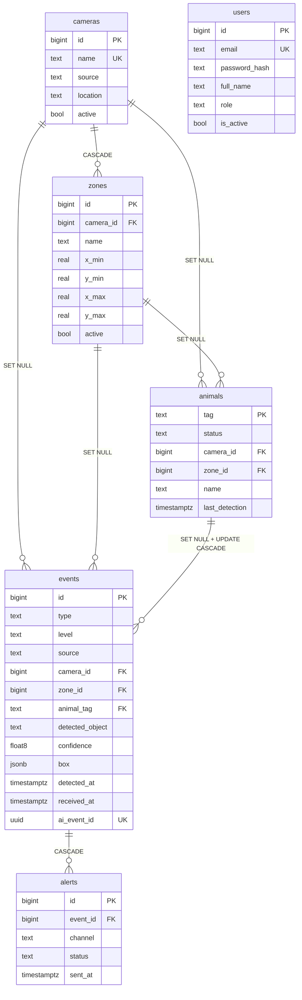

# Modelo de datos

`users` no aparece conectada porque **nada la referencia todavia**. Los eventos
no registran quien los atendio y las alertas no registran a quien se le
mandaron. Cuando exista la autenticacion, `alerts` es la que gana una clave
ajena a `users`.

## Lo que dice el diagrama de un vistazo

Solo dos relaciones borran en cascada: `zones` con su camara y `alerts` con su
evento. Las demas hacen `SET NULL`, y esa asimetria es la regla del esquema:
**el historico sobrevive a que se retire su origen**, salvo cuando la fila no
significa nada sin el.

`animals` a `events` es la unica que ademas lleva `ON UPDATE CASCADE`, porque
es la unica clave ajena que apunta a una clave primaria natural, y una clave
natural si cambia.
